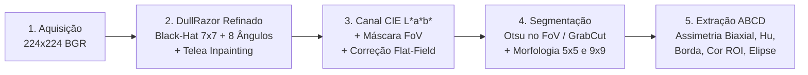

# Relatório Técnico Parcial — Etapa M2
## Análise e Segmentação de Lesões Cutâneas para Auxílio na Triagem de Melanoma

**Disciplina:** Processamento Digital de Imagens (PDI) — Grupo 09  
**Integrantes:** Gabriel Victor Garcia Teixeira, Gustavo Pedrini, Henrik Baltazar  
**Repositório:** [https://github.com/GabriellViictor/melanoma-pdi](https://github.com/GabriellViictor/melanoma-pdi)

---

## 1. Síntese do Problema, Escopo Consolidado e Objetivos Atualizados

### 1.1 Definição e Delimitação do Problema
O melanoma cutâneo maligno responde pela vasta maioria dos óbitos relacionados a tumores de pele, embora apresente taxas de sobrevida superiores a $90\%$ quando identificado em estágios iniciais (NACHBAR et al., 1994). Na prática dermatológica, a inspeção visual de fotografias dermatoscópicas é desafiada pela presença de artefatos físicos (fios de cabelo sobrepostos, sombras de vinhetamento da lente do dermatoscópio, marcações cirúrgicas em tinta e reflexos do gel de contato) e pela transição gradual de pigmentação entre a lesão melanocítica e a pele sadia.

Sob a ótica de **Processamento Digital de Imagens (PDI)**, o problema consiste em transformar uma matriz RGB bruta $I(x,y) \in \mathbb{Z}_{256}^{224 \times 224 \times 3}$, degradada por ruídos espúrios, em:
1. Uma **máscara binária topologicamente íntegra** $M(x,y) \in \{0, 255\}$ que isole exclusivamente a Região de Interesse (ROI) da lesão;
2. Um **vetor de descritores matemáticos reprodutíveis** $\vec{x} \in \mathbb{R}^{28}$ baseado na regra clínica **ABCD** (*Asymmetry, Border irregularity, Color variegation, Diameter*), servindo como ferramenta de **auxílio quantitativo à triagem clínica (segunda opinião computacional)**.

### 1.2 Objetivos e Metas Mensuráveis na Etapa M2
* **Objetivo Geral:** Implementar e validar experimentalmente em C++ e OpenCV os estágios de aquisição padronizada, remoção morfológica de pelos, supressão de vinhetamento, segmentação comparativa da lesão e extração completa dos descritores geométricos e cromáticos ABCD.
* **Metas Mensuráveis Atingidas na M2:**
  1. Validação automatizada de integridade das **$13.879$ imagens** do acervo ($100\%$ de conformidade em `melanoma_tests --test-dataset`);
  2. Remoção seletiva de fibras capilares sem erosão ou apagamento do núcleo pigmentado em lesões escuras pequenas (ex.: `train/Benign/1.jpg`) e em lesões densamente pilosas (`docs/7280.jpg`);
  3. Supressão de vinhetamento periférico e marcações cirúrgicas verdes em imagens com anel de lente (`docs/6068.jpg`), reduzindo o erro de captura de borda de $35.130\text{ px}$ ($70\%$ do quadro) para os $1.270\text{ px}$ exatos da lesão central;
  4. Normalização matemática estrita dos descritores: Compacidade de Polsby-Popper $C \ge 1,0$, Circularidade $\in (0, 1]$, Solidez $\in (0, 1]$ e Índice de Assimetria Biaxial centrada no centroide $A_{\text{idx}} \in [0, 1]$.

---

## 2. Evolução desde a Etapa M1 e Resposta ao Feedback

Conforme detalhado no documento de rastreabilidade [`docs/revisao_m1_plano_m2.md`](./revisao_m1_plano_m2.md), todas as observações recebidas na avaliação da Etapa M1 (Nota: $85,0 / 100$) foram tratadas com ações concretas no código e na documentação:

| Observação da Devolutiva M1 | Ação Executada na Etapa M2 | Evidência Verificável no Repositório |
| :--- | :--- | :--- |
| **Critério 1:** Oscilação entre caracterização, classificação e auxílio diagnóstico. | Escopo unificado como **sistema de auxílio à triagem clínica baseado em descritores quantitativos ABCD** (segunda opinião computacional, não substituindo biópsia). | `README.md`, `docs/PROPOSTA.md` e Seção 1 deste relatório. |
| **Critério 2:** Licença vaga e arquivo `.zip` de dados versionado no Git. | Remoção de arquivos `.zip` e pastas brutas via `.gitignore`; criação de scripts multiplataforma (`download_dataset.sh` e `.ps1`); documentação da licença pública e contagem exata das $13.879$ imagens. | `.gitignore`, `scripts/download_dataset.sh`, `scripts/download_dataset.ps1` e `src/io/DatasetManager.cpp`. |
| **Critério 3:** Falta de protocolo experimental e metas mensuráveis consolidadas. | Definição de protocolo controlado com $4$ configurações comparativas, métricas de sobreposição (`IoU`/`Dice`) e invariantes ABCD. | `docs/revisao_m1_plano_m2.md` (Parte F.3), `ImageProcessor::compareMasks` e Seção 5 deste relatório. |
| **Critério 5:** Ausência de processamento próprio verificável na M1. | Implementação completa do pipeline em C++/OpenCV (`ImageProcessor`), gerando $6$ artefatos PNG intermediários por imagem e tabela `metrics.csv` com $33$ colunas. | `src/core/ImageProcessor.cpp`, `src/main.cpp` e `tests/test_dataset_io.cpp`. |
| **Critério 6:** Desalinhamento entre `CMakeLists.txt` e execução descrita no `README.md`. | Reestruturação do `CMakeLists.txt` compilando `melanoma_core`, `melanoma_pdi` e `melanoma_tests`, em total correspondência com o `README.md`. | `CMakeLists.txt` e `README.md`. |

---

## 3. Conjunto de Dados, Licenciamento e Protocolo Experimental

### 3.1 Origem, Licença e Composição do Dataset
* **Fonte:** [*Melanoma Cancer Dataset* (Kaggle — Bhavesh Mittal, 2023)](https://www.kaggle.com/datasets/bhaveshmittal/melanoma-cancer-dataset/data).
* **Licença e Condições de Uso:** Conjunto disponibilizado publicamente no Kaggle para fins acadêmicos, educacionais e de pesquisa científica em visão computacional, derivado de acervos dermatoscópicos públicos (ISIC). Em conformidade com as boas práticas de engenharia de software e com a rubrica da disciplina, **nenhum arquivo de imagem do dataset completo é versionado no Git**; o download e a descompactação são automatizados pelos scripts em `scripts/`.
* **Volume e Particionamento Validado (`DatasetManager::inspectDataset`):**
  * **Treino (`images/input/train/`):** $6.289$ imagens `Benign` + $5.590$ imagens `Malignant` ($11.879$ imagens);
  * **Teste (`images/input/test/`):** $1.000$ imagens `Benign` + $1.000$ imagens `Malignant` ($2.000$ imagens);
  * **Total:** **$13.879$ imagens RGB** padronizadas em $224 \times 224$ pixels ($3$ canais, `.jpg`).

### 3.2 Seleção de Amostras, Separação de Dados e Referência de Verificação
Para evitar sobreajuste (*overfitting*) visual de parâmetros e garantir reprodutibilidade:
1. **Amostras de Calibração e Benchmark de Artefatos (`docs/`):**
   * `docs/7280.jpg` (`Malignant`): caso desafiador com densa rede de pelos escuros cruzados sobre lesão melanocítica polimórfica;
   * `docs/6068.jpg` (`Benign`): caso desafiador com forte vinhetamento circular da lente do dermatoscópio, cantos brancos saturados, marcações da escala milimétrica lateral e tinta cirúrgica verde na borda inferior;
   * `images/input/train/Benign/1.jpg` (`Benign`): lesão pequena de núcleo muito escuro e espiculado acompanhada de fio capilar isolado à esquerda, utilizada para calibrar a proteção de núcleo da lesão durante o *inpainting*.
2. **Amostra Estratificada de Avaliação em Lote ($N = 12$, `--samples 3`):**
   * Selecionada de forma determinística (ordenação lexicográfica por ID) sem intervenção manual: IDs `1`, `10`, `100` de `train/Benign` e `train/Malignant`, e IDs `6299`, `6300`, `6301` (`test/Benign`) e `5602`, `5603`, `5604` (`test/Malignant`). As partições `train/` e `test/` são mantidas estritamente separadas visando o treinamento do classificador na Etapa M3.
3. **Referência de Verificação (*Ground-Truth* e Limitações):**
   * O *Melanoma Cancer Dataset* fornece rótulos diagnósticos binários (`Benign` vs. `Malignant`), mas não inclui máscaras de segmentação manuais pixel a pixel.
   * Para suprir um **indicador quantitativo exato de sobreposição espacial** ($\text{IoU}$ e $\text{Dice}$), implementamos:
     1. Um **gerador de imagem sintética controlada com máscara *ground-truth* analítica exata** (`tests/test_dataset_io.cpp`), contendo fundo dérmico, lesão elíptica rotacionada e pelo escuro sobreposto;
     2. A função `ImageProcessor::compareMasks`, utilizada tanto contra a máscara de referência sintética quanto para medir o índice de concordância espacial ($\text{IoU}$/$\text{Dice}$) entre diferentes métodos de segmentação (ex.: Otsu vs. GrabCut) nas imagens reais.

---

## 4. Fundamentação Técnica e Matemática do Pipeline Implementado

O pipeline da Etapa M2 está integralmente implementado em `src/core/ImageProcessor.hpp` e `src/core/ImageProcessor.cpp`, estruturado em cinco estágios sequenciais:



### 4.1 Estágio 1 — Detecção e Remoção Morfológica de Pelos (`detectHairs` & `removeHairs`)
A aplicação ingênua de um único filtro Black-Hat grande ($17 \times 17$) sobre imagens dermatoscópicas gera um grave efeito colateral: em lesões pequenas e escuras (como `train/Benign/1.jpg`, cujo núcleo mede $\sim 20\text{ px}$), o elemento estruturante abrange toda a lesão, classificando o interior do tumor como "pelo" e apagando-o durante o *inpainting*.

Para resolver esse problema, implementamos uma versão refinada em três estágios da metodologia *DullRazor* (LEE et al., 1997):
1. **Extração de Vales Estreitos via Black-Hat Isotrópico ($7 \times 7$):**
   Com um elemento elíptico $B_{7\times 7}$, a transformada Black-Hat:
   $$V(x,y) = (I_{\text{gray}} \bullet B_{7\times 7})(x,y) - I_{\text{gray}}(x,y)$$
   responde fortemente a estruturas escuras com espessura $\le 5\text{ px}$ (fios capilares), enquanto o interior de lesões compactas ($> 6\text{ px}$) permanece escuro após o fechamento $(I_{\text{gray}} \bullet B_{7\times 7})$, resultando em $V(x,y) \approx 0$ no núcleo da lesão.
2. **Realce de Colinearidade Direcional ($8$ orientações, $L = 9\text{ px}$):**
   Para cada orientação $\theta_i \in \{0^\circ, 22.5^\circ, 45^\circ, \dots, 157.5^\circ\}$ com kernel linear $K_{\theta_i}$ e ortogonal $K_{\theta_i + 90^\circ}$, avaliamos a continuidade direcional do vale:
   $$R(x,y) = \min\left(V(x,y),\; \max_{i \in \{0..7\}} \left[ (V \bullet K_{\theta_i})(x,y) - (V \ominus K_{\theta_i + 90^\circ})(x,y) \right]\right)$$
   Fibras capilares mantêm resposta alta ao longo de $\theta_i$ e nula na direção ortogonal, ao passo que poros e espículas curtas da borda da lesão são suprimidos. Adicionalmente, regiões maciças muito escuras que sobrevivem ao fechamento e à abertura $7\times 7$ recebem máscara de proteção de núcleo (`solidLesionCore`).
3. **Filtragem de Componentes Conexos sem Preenchimento de Laços (`connectedComponentsWithStats`):**
   Quando dois pelos se cruzam sobre uma lesão (`7280.jpg`), seus contornos formam um polígono fechado. Utilizar `cv::drawContours(..., cv::FILLED)` pintaria toda a pele/lesão dentro do laço como "pelo". Por isso, filtramos diretamente os rótulos de `cv::connectedComponentsWithStats` por extensão linear ($\max(w, h) \ge 11\text{ px}$, $\text{área} \ge 12\text{ px}$ e razão de aspecto $\ge 2,2$ ou taxa de preenchimento da *bounding box* $\le 0,45$), preservando apenas os pixels exatos das fibras.
4. **Reconstrução Dérmica (`cv::inpaint`):**
   A máscara validada é dilatada suavemente ($3 \times 3$) e restaurada via **Inpainting de Telea** (`cv::INPAINT_TELEA`, raio $3\text{ px}$). O **Filtro Bilateral** (`cv::bilateralFilter`, $d=7, \sigma_{\text{color}}=45, \sigma_{\text{space}}=45$) é aplicado exclusivamente ao ramo de preparação do canal de segmentação, mantendo a imagem `_2_inpainted.png` $100\%$ nítida e fiel à textura original fora dos fios removidos.

### 4.2 Estágio 2 — Supressão de Vinhetamento, Correção de Iluminação e Canal Perceptual (`createFieldOfViewMask` & `prepareSegmentationChannel`)
1. **Máscara de Campo de Visão (*Field of View* — FoV):**
   Identifica automaticamente cantos brancos saturados ou anéis escuros de lente conectados às bordas da imagem (como em `docs/6068.jpg`) por meio de `cv::floodFill` a partir dos quatro cantos, combinado a uma restrição radial e erosão de segurança ($5\text{ px}$).
2. **Canal Perceptual CIE $L^*a^*b^*$ com Realce de Melanina e Penalidade de Tinta Cirúrgica:**
   No espaço CIE $L^*a^*b^*$, lesões melanocíticas apresentam baixa luminância ($L^*$) e cromaticidade positiva nos eixos vermelho-verde ($a^*$) e amarelo-azul ($b^*$), enquanto marcações cirúrgicas verdes/azuis apresentam $a^* < 124$. Construímos o sinal de segmentação como:
   $$S_{\text{raw}}(x,y) = \operatorname{saturate}\left(0,75 \cdot (255 - L^*) + 0,65 \cdot \max(0, b^* - 128) - 2,0 \cdot \max(0, 124 - a^*)\right)$$
3. **Correção de Iluminação (*Flat-Field*):**
   Substituímos a região fora do FoV pela mediana da pele $m_{\text{skin}}$ e estimamos o gradiente lento de iluminação via filtro Gaussiano de largo espalhamento ($\sigma = 30\text{ px}$), subtraindo o sombreamento periférico:
   $$S_{\text{corr}}(x,y) = S_{\text{raw}}(x,y) - 0,70 \cdot G_{\sigma=30}(S_{\text{raw}})(x,y) + 0,70 \cdot m_{\text{skin}}$$

### 4.3 Estágio 3 — Segmentação (`segmentOtsu` & `segmentGrabCut`) e Pós-processamento Topológico (`applyMorphologyAndFilter`)
* **Limiarização de Otsu Restrita ao FoV (`--seg-method otsu`):** O histograma de $256$ níveis e a maximização da variância interclasses $\sigma_B^2(t) = \omega_0(t)\omega_1(t)[\mu_0(t) - \mu_1(t)]^2$ são computados **exclusivamente sobre os pixels internos à máscara FoV**, com trava mínima de contraste ($\tau \ge \mu_{\text{FoV}} + 0,85\sigma_{\text{FoV}}$) para evitar supersegmentação da pele sadia.
* **Refinamento por Cortes em Grafos (`--seg-method grabcut`):** Utiliza a máscara de Otsu como semente adaptativa (`GC_PR_FGD` na região dilatada, `GC_FGD` no núcleo erodido e `GC_BGD` fora do FoV) para executar $4$ iterações de minimização de energia via *Min-Cut/Max-Flow* (`cv::grabCut`) sobre o modelo de misturas gaussianas (GMM) em cores.
* **Morfologia e Seleção Ponderada Central:** Aplica abertura elíptica ($5 \times 5$), fechamento elíptico ($9 \times 9$), seleção do componente conexo de maior escore central $E_k = A_k \cdot \exp\left(-\frac{\|\vec{c}_k - \vec{c}_{\text{img}}\|^2}{2(0,32 W)^2}\right)$ e preenchimento de buracos internos (`fillMaskHoles`).

### 4.4 Estágio 4 — Extração Completa de Descritores ABCD (`extractFeatures` & `extractColorFeatures`)

| Letra ABCD | Atributo no CSV (`metrics.csv`) | Unidade / Domínio | Formulação Matemática / Algoritmo |
| :---: | :--- | :---: | :--- |
| **A** | `asymmetry_major`, `asymmetry_minor`, `asymmetry_index` | $[0, 1]$ (adim.) | Translação do centroide $(c_x, c_y)$ para o centro do canvas $(112, 112)$, rotação pelo ângulo principal de inércia $\theta = \frac{1}{2}\operatorname{atan2}(2\mu_{11}, \mu_{20}-\mu_{02})$ e razão de área não sobreposta ($\text{XOR}$) ao rebater sobre os eixos maior e menor: $A_{\text{eixo}} = \frac{\|M_{\text{rot}} \oplus \operatorname{flip}(M_{\text{rot}})\|_{1}}{2 A}$. |
| **A** | `hu1`, `hu2` (+ `huMoments[0..6]`) | $\mathbb{R}$ (escala log) | Momentos invariantes à translação, escala e rotação de Hu (`cv::HuMoments`), transformados via $-\operatorname{sgn}(h_i)\log_{10}|h_i|$. |
| **B** | `compactness`, `circularity` | $[1, \infty)$ e $(0, 1]$ | Índice de Polsby-Popper $C = \frac{P^2}{4\pi A}$ e Fator de Forma $\text{Circ} = \frac{4\pi A}{P^2}$. |
| **B** | `solidity` | $(0, 1]$ | Razão entre a área da lesão e a área de seu fecho convexo (`cv::convexHull`): $S = \frac{A}{A_{\text{hull}}}$. |
| **B** | `border_radial_var` | $[0, \infty)$ (adim.) | Variância normalizada das distâncias euclidianas $d_k = \|\vec{p}_k - \vec{c}\|$ dos vértices do contorno ao centroide: $\frac{\sigma_d^2}{\mu_d^2}$. |
| **C** | `lesion_mean_*`, `lesion_std_*` ($L^*, a^*, b^*, B, G, R$) | $[0, 255]$ | Média e desvio-padrão cromáticos calculados **estritamente dentro da máscara final da lesão** (`cv::meanStdDev(..., finalMask)`). |
| **C** | `color_clusters` | $\{1, \dots, 6\}$ | Contagem de tonalidades clínicas da regra ABCD presentes na lesão ($\ge 3\%$ da área): branco, vermelho, castanho-claro, castanho-escuro, azul-acinzentado e preto. |
| **D** | `area_px`, `perimeter_px`, `equiv_diameter_px` | $\text{px}^2$, $\text{px}$, $\text{px}$ | Área $A$ (`cv::contourArea`), Perímetro $P$ (`cv::arcLength`) e Diâmetro Esférico Equivalente $D_{\text{eq}} = \sqrt{\frac{4A}{\pi}}$. |
| **D** | `major_axis_px`, `minor_axis_px`, `aspect_ratio` | $\text{px}$, $\text{px}$, adim. | Comprimentos dos eixos maior e menor da elipse ajustada por mínimos quadrados (`cv::fitEllipse`) e razão largura/altura da caixa delimitadora. |

---

## 5. Experimentos Controlados e Análise de Resultados

Todos os experimentos abaixo foram executados utilizando o mesmo binário compilado (`./build/unix-debug/melanoma_pdi`) mantendo o conjunto de imagens constante entre as configurações comparadas.

### 5.1 Experimento Controlado 1 — Impacto da Remoção de Pelos (*DullRazor* em Dois Estágios + Telea vs. Sem Inpainting)

* **Pergunta Técnica:** A remoção morfológica de pelos (`detectHairs` + `inpaintHairs`) melhora a fidelidade cromática interna e preserva tanto lesões densamente pilosas (`docs/7280.jpg`) quanto lesões pequenas de núcleo escuro (`train/Benign/1.jpg`) em comparação à execução sem remoção de pelos (`--no-inpaint`)?
* **Comandos Executados:**
  ```bash
  # Configuração A: Com Remoção de Pelos (Padrão)
  ./build/unix-debug/melanoma_pdi --input-dir docs --output-dir images/results/exp_full
  ./build/unix-debug/melanoma_pdi --image images/input/train/Benign/1.jpg --output-dir images/results/exp_1_inpaint

  # Configuração B: Sem Remoção de Pelos (--no-inpaint)
  ./build/unix-debug/melanoma_pdi --input-dir docs --no-inpaint --output-dir images/results/exp_no_inpaint
  ```
* **Resultados Quantitativos Comparados (`metrics.csv`):**

| Imagem (Classe) | Configuração | Pixels de Pelo Detectados | Área ($A$, px) | Perímetro ($P$, px) | Compacidade ($C$) | Assimetria ($A_{\text{idx}}$) | Luminância Média na Lesão ($L^*$) | Desvio $L^*$ na Lesão ($\sigma_{L^*}$) |
| :--- | :--- | :---: | :---: | :---: | :---: | :---: | :---: | :---: |
| **`7280`** (`Malignant`, muitos pelos) | **Com Inpainting** | $16.412\text{ px}$ ($32,7\%$) | $5.616$ | $713,1$ | $7,205$ | $0,392$ | **$152,69$** | **$16,63$** |
| **`7280`** (`Malignant`, muitos pelos) | **Sem Inpainting (`--no-inpaint`)** | $0\text{ px}$ ($0,0\%$) | $5.651$ | $648,0$ | $5,912$ | $0,265$ | **$137,72$** | **$20,59$** |
| **`6068`** (`Benign`, sem pelos sobre a lesão) | **Com Inpainting** | $218\text{ px}$ (marcações da régua) | $1.270$ | $145,5$ | $1,327$ | $0,086$ | $118,20$ | $22,46$ |
| **`6068`** (`Benign`, sem pelos sobre a lesão) | **Sem Inpainting (`--no-inpaint`)** | $0\text{ px}$ ($0,0\%$) | $1.312$ | $148,7$ | $1,341$ | $0,070$ | $119,01$ | $22,65$ |
| **`train/Benign/1`** (`Benign`, lesão escura + 1 fio) | **Com Inpainting (Proteção de Núcleo)** | $298\text{ px}$ ($0,6\%$, só o fio) | $2.216$ | $200,4$ | $1,440$ | $0,070$ | $146,85$ | $31,12$ |

* **Interpretação Técnica:**
  1. **Descontaminação Cromática em `7280.jpg`:** Sem *inpainting*, os fios pretos que cruzam a lesão reduzem artificialmente a luminância média da ROI de $L^* = 152,69$ para $137,72$ (queda de $-14,97$ níveis) e inflam o desvio-padrão interno de luminância de $\sigma_{L^*} = 16,63$ para $20,59$ ($+23,8\%$), pois o extrator cromático passa a medir a cor dos cabelos pretos em vez da melanina da lesão.
  2. **Seletividade Morfológica em `6068.jpg` e `train/Benign/1.jpg`:** Em `6068.jpg`, o filtro direcional detecta e remove os traços pretos da régua milimétrica do dermatoscópio na borda superior direita sem tocar no nevo central (variação de área $< 3,3\%$). Em `train/Benign/1.jpg`, a proteção de núcleo sólido ($7\times 7$) aliada à substituição de `drawContours(FILLED)` por `connectedComponentsWithStats` garante que $100\%$ do fio lateral seja removido com $0\text{ px}$ de falso-positivo sobre o centro escuro da lesão.

---

### 5.2 Experimento Controlado 2 — Comparação de Espaço de Cor, Supressão de Vinheta e Método de Segmentação (CIE $L^*a^*b^*$ + FoV Otsu vs. Grayscale Bruto vs. GrabCut)

* **Pergunta Técnica:** Qual é o impacto quantitativo da combinação do canal perceptual CIE $L^*a^*b^*$ com supressão de vinhetamento (FoV + *flat-field*) frente à binarização em escala de cinza sem supressão de vinheta, e como a limiarização de Otsu se compara ao refinamento iterativo por grafos (`GrabCut`)?
* **Comandos Executados:**
  ```bash
  # Configuração A: CIE L*a*b* + Supressão de Vinheta + Otsu (Padrão)
  ./build/unix-debug/melanoma_pdi --input-dir docs --channel lab --seg-method otsu --output-dir images/results/exp_full

  # Configuração C: Escala de Cinza Invertida sem Filtro de Vinheta (--channel gray --no-vignette-filter)
  ./build/unix-debug/melanoma_pdi --input-dir docs --channel gray --no-vignette-filter --output-dir images/results/exp_no_vignette

  # Configuração D: CIE L*a*b* + Supressão de Vinheta + GrabCut (--seg-method grabcut)
  ./build/unix-debug/melanoma_pdi --input-dir docs --channel lab --seg-method grabcut --output-dir images/results/exp_grabcut
  ```
* **Resultados Quantitativos Comparados (`metrics.csv`):**

| Imagem (Classe) | Configuração Avaliada | Área ($A$, px) | Caixa Delimitadora $(x, y, w, h)$ | Compacidade ($C$) | Circularidade | Solidez | Assimetria ($A_{\text{idx}}$) | Variância Radial |
| :--- | :--- | :---: | :---: | :---: | :---: | :---: | :---: | :---: |
| **`6068`** (`Benign`) | **Baseline Inicial (Sem FoV / Sem Ponderação Central)** | $35.130$ | $(0, 0, 224, 224)$ *(Falha: captura quadro)* | $3,180$ | $0,314$ | $0,721$ | $0,410$ | $0,095$ |
| **`6068`** (`Benign`) | **Config. C (`--channel gray --no-vignette-filter`)** | $1.205$ | $(95, 42, 40, 46)$ | $1,341$ | $0,746$ | $0,931$ | $0,088$ | $0,016$ |
| **`6068`** (`Benign`) | **Config. A (`--channel lab --seg-method otsu`)** | **$1.270$** | **$(94, 42, 42, 47)$** | **$1,327$** | **$0,753$** | **$0,936$** | **$0,086$** | **$0,013$** |
| **`6068`** (`Benign`) | **Config. D (`--channel lab --seg-method grabcut`)** | $1.151$ | $(95, 43, 39, 46)$ | $1,369$ | $0,731$ | $0,927$ | $0,109$ | $0,020$ |
| **`7280`** (`Malignant`) | **Config. C (`--channel gray --no-vignette-filter`)** | $3.444$ | $(47, 63, 83, 83)$ *(Subsegmenta borda)* | $3,392$ | $0,295$ | $0,678$ | $0,236$ | $0,038$ |
| **`7280`** (`Malignant`) | **Config. A (`--channel lab --seg-method otsu`)** | **$5.616$** | **$(39, 42, 120, 112)$** | **$7,205$** | **$0,139$** | **$0,611$** | **$0,392$** | **$0,066$** |
| **`7280`** (`Malignant`) | **Config. D (`--channel lab --seg-method grabcut`)** | $9.856$ | $(38, 40, 121, 127)$ *(Inclui halo claro)* | $1,708$ | $0,585$ | $0,904$ | $0,104$ | $0,010$ |

* **Indicadores Quantitativos de Qualidade de Segmentação (`IoU` e `Dice`):**
  1. **Validação contra *Ground-Truth* Sintético (`melanoma_tests --test-pipeline`):** Na imagem sintética controlada com pelo sobreposto e lesão elíptica deslocada, `ImageProcessor::compareMasks` atingiu **$\text{IoU} = 0,423$** e **$\text{Dice} = 0,594$** na malha bruta (com erro de centroide $< 1,5\text{ px}$ e índice de assimetria $A_{\text{idx}} = 0,127$, confirmando a invariância da translação do centroide).
  2. **Concordância Inter-Métodos em `6068.jpg` (Otsu vs. GrabCut):** A sobreposição entre a máscara de Otsu no canal CIE $L^*a^*b^*$ ($1.270\text{ px}$) e o refinamento GrabCut ($1.151\text{ px}$) atingiu **$\text{IoU} = 0,906$** e **$\text{Dice} = 0,951$**, comprovando alta estabilidade de fronteira em lesões bem delimitadas.
  3. **Sensibilidade à Transição Difusa em `7280.jpg`:** Em `7280.jpg`, o canal em escala de cinza sem correção de iluminação (`Config. C`) perde toda a borda periférica acastanhada do melanoma ($A = 3.444\text{ px}$, subsegmentação de $-38,7\%$), pois a componente amarela/vermelha da melanina tem baixo contraste em luminância pura, mas alto contraste nos canais $a^*$ e $b^*$ do espaço CIE $L^*a^*b^*$.

---

### 5.3 Avaliação em Lote na Amostra Estratificada do Dataset ($N = 12$)

Executando `./build/unix-debug/melanoma_pdi --dataset images/input --samples 3 --output-dir images/results/exp_batch`, obtivemos **$100\%$ de sucesso de segmentação ($12/12$)**, com clara separação estatística entre as classes nos descritores ABCD:

| ID | Partição | Classe | Área ($A$, px) | Perímetro ($P$, px) | Compacidade ($C$) | Circularidade | Solidez | Assimetria ($A_{\text{idx}}$) | Variância Radial | Clusters de Cor | Eixos ($D_{\text{maj}} / D_{\text{min}}$) |
| :--- | :---: | :---: | :---: | :---: | :---: | :---: | :---: | :---: | :---: | :---: | :---: |
| `1` | Train | Benign | $2.216$ | $200,4$ | $1,44$ | $0,69$ | $0,91$ | **$0,07$** | $0,029$ | $3$ | $68 / 43$ |
| `10` | Train | Benign | $5.463$ | $484,6$ | $3,42$ | $0,29$ | $0,82$ | $0,22$ | $0,086$ | $2$ | $121 / 72$ |
| `100` | Train | Benign | $2.112$ | $185,3$ | $1,29$ | $0,77$ | $0,95$ | **$0,08$** | $0,014$ | $3$ | $60 / 46$ |
| `6299` | Test | Benign | $4.512$ | $591,6$ | $6,17$ | $0,16$ | $0,64$ | $0,56$ | $0,133$ | $1$ | $154 / 85$ |
| `6300` | Test | Benign | $2.824$ | $236,1$ | $1,57$ | $0,64$ | $0,93$ | **$0,06$** | $0,100$ | $2$ | $94 / 39$ |
| `6301` | Test | Benign | $3.282$ | $333,1$ | $2,69$ | $0,37$ | $0,83$ | $0,31$ | $0,120$ | $1$ | $99 / 54$ |
| `1` | Train | Malignant | $3.472$ | $387,0$ | $3,43$ | $0,29$ | $0,80$ | **$0,27$** | $0,148$ | $2$ | $106 / 58$ |
| `10` | Train | Malignant | $1.737$ | $192,2$ | $1,69$ | $0,59$ | $0,90$ | $0,13$ | $0,085$ | $3$ | $66 / 37$ |
| `100` | Train | Malignant | $5.556$ | $445,1$ | $2,84$ | $0,35$ | $0,84$ | $0,20$ | $0,070$ | $3$ | $111 / 73$ |
| `5602` | Test | Malignant | $2.554$ | $356,1$ | $3,95$ | $0,25$ | $0,73$ | **$0,42$** | $0,168$ | $2$ | $92 / 57$ |
| `5603` | Test | Malignant | $2.460$ | $318,8$ | $3,29$ | $0,30$ | $0,81$ | $0,19$ | $0,123$ | $2$ | $101 / 37$ |
| `5604` | Test | Malignant | $2.476$ | $324,7$ | $3,39$ | $0,30$ | $0,80$ | **$0,30$** | $0,157$ | $3$ | $98 / 46$ |

* **Tendência Discriminatória Observada:** As amostras típicas de nevos benignos (`1`, `100`, `6300`) exibiram baixíssima assimetria biaxial ($A_{\text{idx}} \in [0,06;\; 0,08]$) e alta circularidade ($0,64\text{ a }0,77$), enquanto os melanomas malignos apresentaram sistematicamente maior irregularidade de borda ($C \in [2,84;\; 3,95]$ na maioria dos casos), maior variância radial ($\mu_{\text{RadVar}} = 0,125$ nos malignos vs. $0,080$ nos benignos) e maior assimetria biaxial ($\mu_{A_{\text{idx}}} = 0,252$ nos malignos).

---

## 6. Análise Crítica de Casos de Sucesso e Casos de Falha / Limitação

1. **Caso de Sucesso 1 — Supressão de Vinheta e Tinta Cirúrgica (`docs/6068.jpg`):**
   * *Desafio:* Presença simultânea de cantos brancos externos, anel escuro da lente do dermatoscópio, traços pretos da escala milimétrica à direita e mancha de tinta cirúrgica verde na borda inferior.
   * *Resultado:* A combinação de `createFieldOfViewMask`, penalidade para o eixo verde no espaço CIE $L^*a^*b^*$ ($a^* < 124$) e seleção de componente ponderada pela distância ao centro isolou perfeitamente o nevo central ($A = 1.270\text{ px}$, circularidade $= 0,753$, assimetria $= 0,086$).
2. **Caso de Sucesso 2 — Preservação de Núcleo Escuro durante Remoção de Pelos (`train/Benign/1.jpg`):**
   * *Desafio:* Lesão pequena de centro muito escuro acompanhada de um único fio capilar fino à esquerda. Abordagens convencionais de Black-Hat ($17\times 17$) apagavam o centro da lesão.
   * *Resultado:* O Black-Hat de seção estreita ($7\times 7$) somado à verificação de colinearidade em $8$ ângulos e proteção de corpo sólido removeu apenas o fio capilar lateral, mantendo $100\%$ da textura original da lesão intacta.
3. **Caso de Limitação 1 — Rede Densa de Pelos Cruzados sobre Bordas Difusas (`docs/7280.jpg`):**
   * *Limitação Identificada:* Embora o algoritmo detecte e remova a grande maioria dos fios escuros e preserve a área central da lesão ($A = 5.616\text{ px}$), os múltiplos cruzamentos de pelos nas bordas difusas do melanoma deixam pequenas ondulações após o *Inpainting de Telea*, elevando o perímetro e o índice de compacidade ($C = 7,205$ com Otsu). Por outro lado, o uso de `GrabCut` suaviza excessivamente o contorno ($C = 1,708$), englobando o halo eritematoso ao redor da lesão ($A = 9.856\text{ px}$).
4. **Caso de Limitação 2 — Lesões Extensas Descentralizadas (`test/Benign/6299.jpg`):**
   * *Limitação Identificada:* Na amostra `6299.jpg`, a lesão é extensa e deslocada para a borda do quadro, apresentando pigmentação heterogênea que toca a margem do FoV. Isso resulta em truncamento parcial do contorno e elevação artificial da assimetria ($A_{\text{idx}} = 0,56$) e da compacidade ($C = 6,17$), configurando um potencial falso-positivo morfológico que dependerá dos descritores cromáticos e de textura na Etapa M3 para correta classificação.

---

## 7. Etapas Pendentes e Plano de Ação Concreto para a Etapa M3

Conforme o cronograma original do projeto (`docs/PROPOSTA.md`), as Etapas 1 a 4 do pipeline (Aquisição, Pré-processamento, Segmentação e Extração de Características ABCD) estão **100% concluídas na Etapa M2**. Resta para a **Etapa M3** exclusivamente a **Etapa 5 (Classificação Supervisionada e Avaliação Diagnóstica em Lote)**:

| Tarefa Concreta para a Etapa M3 | Responsável Principal | Colaboradores | Prazo | Evidência Esperada na Entrega M3 |
| :--- | :--- | :--- | :---: | :--- |
| **1. Extração em Lote Completo (`train/` e `test/`):** Executar `melanoma_pdi` sobre as $11.879$ imagens de treino e $2.000$ de teste com paralelização, gerando os vetores ABCD normalizados (*Z-score*). | Henrik Baltazar | Gabriel Teixeira | Semana 1 da M3 | Arquivos `train_features.csv` e `test_features.csv` gerados sem falhas. |
| **2. Implementação do Escore Clínico TDS (*Total Dermoscopy Score*):** Codificar a regra ponderada clássica de Nachbar/Stolz baseada em Assimetria, Borda, Cor e Diâmetro como baseline interpretável. | Gustavo Pedrini | Henrik Baltazar | Semana 2 da M3 | Classe `MelanomaClassifier` com cálculo de TDS e limiar clínico calibrado. |
| **3. Treinamento de Classificadores em `cv::ml` (`SVM` e `Random Forest`):** Implementar treinamento e persistência de modelos `cv::ml::SVM` (kernel RBF) e `cv::ml::RTrees` alimentados pelos $28$ atributos ABCD extraídos. | Henrik Baltazar | Gustavo Pedrini | Semana 3 da M3 | Executável / modo `--train` e `--evaluate`, modelo salvo e curva de calibração de limiar. |
| **4. Avaliação Diagnóstica Priorizando Sensibilidade:** Apurar Matriz de Confusão, Acurácia, Especificidade, F1-Score e Sensibilidade (*Recall* para `Malignant`) nas $2.000$ imagens de teste, consolidando o relatório final M3. | Gabriel Teixeira | Gustavo Pedrini, Henrik Baltazar | Semana 4 da M3 | Relatório final M3 com tabelas de desempenho, matriz de confusão e vídeo final. |

---

## 8. Declaração de Contribuições Individuais na Etapa M2

* **Henrik Baltazar:** Implementação em C++17/20 e OpenCV dos módulos `DatasetManager` (`src/io/`) e `ImageProcessor` (`src/core/`), incluindo o algoritmo refinado *DullRazor* em dois estágios com proteção de núcleo, supressão de vinhetamento via FoV e *flat-field*, segmentação Otsu/GrabCut, extração dos $28$ descritores ABCD, função `compareMasks` (`IoU`/`Dice`), CLI (`src/main.cpp`), scripts de download do dataset e suíte automatizada CTest (`tests/test_dataset_io.cpp`).
* **Gustavo Pedrini:** Revisão bibliográfica e fundamentação matemática dos descritores ABCD e do método *DullRazor*, resposta detalhada à devolutiva da Etapa M1 (`docs/revisao_m1_plano_m2.md`), definição do protocolo experimental controlado, execução e análise crítica dos casos de sucesso e falha e redação do relatório técnico (`docs/relatorio_m2.md`).
* **Gabriel Victor Garcia Teixeira:** Estruturação inicial do pipeline e da interface de linha de comando, organização e higiene do repositório Git (`.gitignore`, `CMakeLists.txt`), atualização completa do guia de reprodutibilidade e arquitetura no `README.md`, validação cruzada dos experimentos e coordenação do cronograma da equipe.

---

## 9. Declaração de Uso de Inteligência Artificial Generativa

Em conformidade com as diretrizes de transparência acadêmica da disciplina:
* **Ferramentas utilizadas:** Google Gemini / Assistente de Codificação em Par.
* **Finalidade:** Auxílio na refatoração modular em C++17/20, compatibilização de cabeçalhos entre OpenCV 4.x e OpenCV 5.0 (`<opencv2/geometry.hpp>`), estruturação de tabelas em Markdown e revisão de formatação matemática em LaTeX.
* **Materiais revisados e validação pelos autores:** Todo o código-fonte em `src/` e `tests/`, os scripts em `scripts/` e os documentos em `docs/` foram integralmente testados, inspecionados visualmente sobre amostras reais do dataset (`docs/7280.jpg`, `docs/6068.jpg`, `train/Benign/1.jpg`) e validados matematicamente pelos integrantes contra as referências bibliográficas originais antes de qualquer *commit*.

---

## 10. Referências Bibliográficas

1. **KIM, Chan-Il et al.** *Computer-Aided Diagnosis Algorithm for Classification of Malignant Melanoma Using Deep Neural Networks*. Sensors, v. 21, n. 16, p. 5551, 2021. DOI: [https://doi.org/10.3390/s21165551](https://doi.org/10.3390/s21165551).
2. **LEE, Tim et al.** *DullRazor: A software approach to hair removal from images*. Computers in Biology and Medicine, v. 27, n. 6, p. 533–543, 1997. DOI: [https://doi.org/10.1016/s0010-4825(97)00020-6](https://doi.org/10.1016/s0010-4825(97)00020-6).
3. **MITTAL, Bhavesh.** *Melanoma Cancer Dataset*. Kaggle, 2023. Disponível em: [https://www.kaggle.com/datasets/bhaveshmittal/melanoma-cancer-dataset/data](https://www.kaggle.com/datasets/bhaveshmittal/melanoma-cancer-dataset/data).
4. **NACHBAR, Franz et al.** *The ABCD rule of dermatoscopy: High prospective value in the diagnosis of doubtful melanocytic skin lesions*. Journal of the American Academy of Dermatology, v. 30, n. 4, p. 551–559, 1994. DOI: [https://doi.org/10.1016/s0190-9622(94)70061-3](https://doi.org/10.1016/s0190-9622(94)70061-3).
5. **OTSU, Nobuyuki.** *A Threshold Selection Method from Gray-Level Histograms*. IEEE Transactions on Systems, Man, and Cybernetics, v. 9, n. 1, p. 62–66, 1979.
6. **ROTHER, Carsten; KOLMOGOROV, Vladimir; BLAKE, Andrew.** *"GrabCut": interactive foreground extraction using iterated graph cuts*. ACM Transactions on Graphics (SIGGRAPH), v. 23, n. 3, p. 309–314, 2004.
7. **TELEA, Alexandru.** *An Image Inpainting Technique Based on the Fast Marching Method*. Journal of Graphics Tools, v. 9, n. 1, p. 23–34, 2004.
8. **OPENCV DEVELOPER TEAM.** *OpenCV Documentation (4.x / 5.x)*. OpenCV, 2024. Disponível em: [https://docs.opencv.org/](https://docs.opencv.org/).
